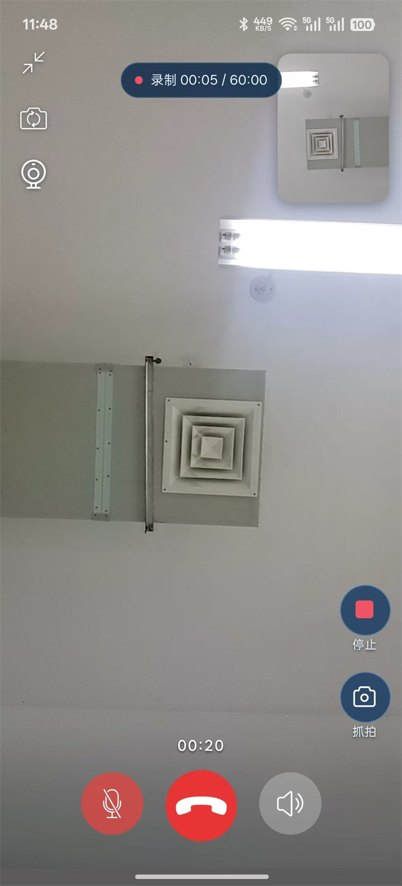
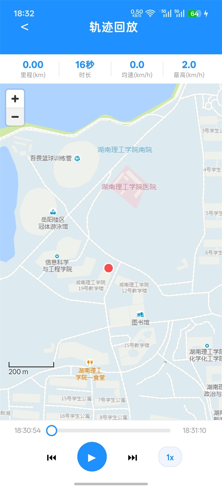
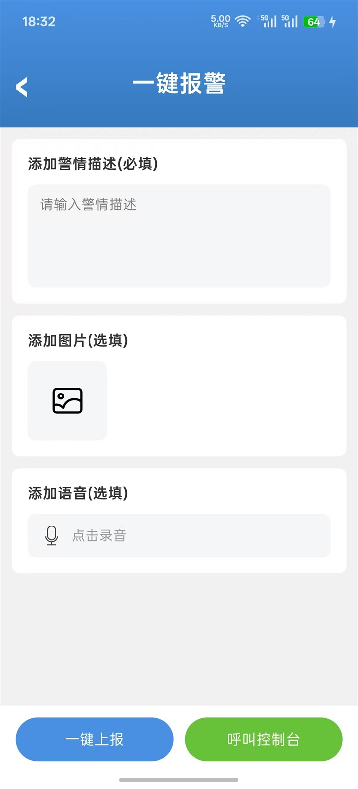
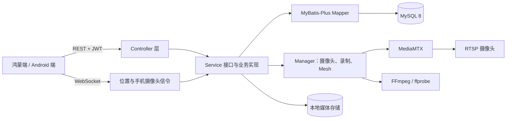

# 可视化指挥调度管理系统（后端）

这是一个面向应急指挥与现场协同场景的多端联动项目。系统以地图为主界面，将人员定位、即时通信、音视频通话、摄像头接入、轨迹回放和告警上报放进同一套业务流程。后端提供 REST API 与 WebSocket 服务，支撑鸿蒙端和 Android 端的联调。

我在项目中负责后端开发，工作内容包括数据库设计、接口定义、业务实现、媒体与设备能力接入、权限控制以及测试。移动端 App 由团队成员完成，本仓库不包含鸿蒙端和 Android 端的源代码。

## 项目概览

| 说明项 | 内容 |
| --- | --- |
| 项目性质 | 多端协同项目，已完成主要业务开发与联调 |
| 我的职责 | 后端设计与开发：数据库、REST/WebSocket、业务、媒体接入、测试 |
| 客户端 | 鸿蒙端、Android 端，由团队成员开发，源码不在本仓库 |
| 服务端技术 | Java 21、Spring Boot 3.4、MyBatis-Plus、MySQL 8、Flyway |
| 安全与通信 | Spring Security、JWT、BCrypt、WebSocket |
| 媒体能力 | MediaMTX、FFmpeg、ffprobe、RTSP、WebRTC、HLS、ONVIF |

## 界面预览

以下截图来自项目真实联调环境。截图中的客户端界面由团队成员开发，我负责这些功能对应的后端接口、数据和媒体服务；账号、位置、设备及媒体信息均为演示数据。

| 主界面 | Mesh 设备拓扑 | 调度通讯录 |
| :---: | :---: | :---: |
|  |  |  |
| 地图定位、对讲与采集入口 | 现场设备连接关系 | 联系人及调度方式 |

| 视频通话 | 历史轨迹回放 | 一键报警 |
| :---: | :---: | :---: |
|  |  |  |
| 通话、录制与状态控制 | 按时间段回放人员轨迹 | 报警上报及现场信息 |

## 功能概览

| 模块 | 主要能力 |
| --- | --- |
| 用户与组织 | 登录、受控注册、管理员初始化、用户管理、联系人、群组与群成员权限 |
| 即时通信 | 单聊与群聊、引用、撤回、删除、未读数、聊天媒体上传及 WebSocket 推送 |
| 音视频通话 | 通话记录、忙线状态、录制任务控制、服务端媒体检查与 FFmpeg 合成 |
| 视频与摄像头 | ONVIF/RTSP 接入、MediaMTX 流路径管理、WebRTC/HLS 播放、诊断与兼容转码 |
| 手机摄像头 | 手机端推流注册、观看端信令及 WebSocket 会话管理 |
| 地图与定位 | 实时位置上报、在线状态、轨迹会话、历史轨迹回放、离线地图瓦片管理 |
| 告警与设备 | 一键报警、告警媒体、Mesh 设备代理、字典数据与操作审计 |
| 工程能力 | 参数校验、统一异常处理、逻辑删除、数据库迁移、接口契约回归测试 |

## 技术栈

| 组件 | 版本 |
| :---: | :---: |
| Java | 21 |
| Spring Boot | 3.4.13 |
| Spring Framework | 6.2.15 |
| Spring Security | 6.4.13 |
| Spring WebSocket | 6.2.15 |
| MyBatis-Plus | 3.5.17 |
| MySQL | 8.0+（Connector/J 9.5.0） |
| Flyway | 10.20.1 |
| JJWT | 0.12.6 |
| Jackson | 2.18.5 |
| Lombok | 1.18.42 |
| 内嵌 Tomcat | 10.1.50 |
| Maven | 3.9+ |
| MediaMTX | 独立部署 |
| FFmpeg / ffprobe | 外部依赖 |
| 联调页面 | 原生 HTML / CSS / JavaScript |

## 技术架构



后端沿 `Controller -> Service -> Manager/Mapper` 的方向组织调用关系，外部媒体组件被封装在 Manager 层，避免将第三方协议细节直接写进业务服务。

## 我在项目中的工作

- 负责 MySQL 数据模型、可重复执行的初始化脚本 `sql/communication.sql`，以及 Flyway 增量迁移。
- 按职责拆分 Controller、Service、Manager、Mapper；业务接口与实现分离，外部媒体能力单独封装。
- 实现 JWT 登录鉴权、BCrypt 密码存储、注册开关、管理员引导创建及资源归属校验。
- 实现用户、群组、聊天、位置、轨迹、告警、摄像头、通话记录等模块的 REST 接口。
- 实现位置推送和手机摄像头信令两个 WebSocket 通道，并处理连接鉴权与会话生命周期。
- 封装 RTSP/ONVIF、MediaMTX、FFmpeg/ffprobe 等能力，处理媒体探活、兼容转码、录制与流式读取。
- 编写单元测试和接口契约基线，确保整改代码结构时不改变已有路由和 JSON 字段。

## 关键设计

### 分层与接口边界

- `controller` 负责请求参数、当前用户上下文和响应封装，不直接处理文件或第三方协议。
- `service` 存放业务接口，`service.impl` 存放对应实现。
- `manager` 封装摄像头、录制、Mesh 等外部能力，并按业务域继续拆分子包。
- `mapper` 负责持久化访问，`dto`、`vo`、`entity` 和 `model` 分别承载不同层次的数据模型。

### 鉴权与数据安全

- 使用 Spring Security + JWT 完成无状态认证，密码通过 BCrypt 保存。
- 涉及用户、群组、会话和媒体的操作会校验当前用户及资源归属。
- 注册默认关闭；首次管理员通过 `BOOTSTRAP_ADMIN_PASSWORD` 创建，不在 SQL 中写入固定默认密码。
- 敏感配置和数据库口令通过环境变量提供，仓库不保存真实密钥。
- 关键操作写入审计日志，业务表使用逻辑删除避免直接丢失历史数据。

### 实时通信

- `/ws/location` 用于位置与在线状态推送。
- `/ws/phone-camera` 用于手机摄像头注册、观看端加入及推流信令转发。
- WebSocket 建连时进行令牌校验，会话关闭后清理在线状态和关联资源。
- 消息持久化与实时推送分开处理，客户端重连后仍可读取未读消息。

### 媒体与设备接入

- 聊天媒体和视频接口支持 HTTP Range，可拖动进度并按区间读取文件。
- 上传文件会校验扩展名与文件头，避免仅凭客户端文件名判断类型。
- 固定摄像头支持手动填写 RTSP，也可通过 ONVIF 获取流地址。
- MediaMTX 路径按摄像头生命周期创建、恢复和删除；播放前读取真实轨道状态，再决定直出还是兼容转码。
- 通话录制使用独立任务和受控线程池，由 ffprobe 检查媒体，再由 FFmpeg 完成合成。

### 数据迁移与接口契约

- `sql/communication.sql` 用于创建新环境，脚本可重复执行且不覆盖已有业务数据。
- `src/main/resources/db/migration` 中的 Flyway 脚本负责后续结构升级，存量数据库不使用初始化脚本代替迁移。
- 启动时校验数据库端口、库名和可选实例 UUID，降低连接到错误 MySQL 实例的风险。
- `ApiContractBaselineTest` 固化 122 条 REST 路由和 59 个 JSON 结构，结构整改后仍需保持原接口兼容。

## 接口与测试

主要入口：

- REST：`/api/**`
- 位置 WebSocket：`/ws/location`
- 手机摄像头 WebSocket：`/ws/phone-camera`

当前测试基线：

```text
Tests: 225, Failures: 0, Errors: 0, Skipped: 9
```

跳过的测试主要依赖真实 MediaMTX、RTSP 或 FFmpeg 环境，其余单元测试可直接运行：

```bash
mvn test
```

接口契约基线位于 `src/test/resources/api-contract-baseline.txt`。该测试会比较控制器的实际路由、请求方法、返回类型和 JSON 属性名，适合在重构或规范整改后做兼容性检查。

## 本地运行

### 环境要求

- JDK 21
- Maven 3.9+
- MySQL 8.0+
- 可选：MediaMTX、FFmpeg、ffprobe，用于摄像头和通话录制功能

### 1. 初始化数据库

在项目根目录打开终端，进入 MySQL 客户端：

```bash
mysql --default-character-set=utf8mb4 -u root -p
```

然后在 MySQL 客户端中导入初始化脚本：

```sql
SOURCE sql/communication.sql;
```

脚本会创建 `communication` 数据库、基础表和演示种子数据。应用首次启动后，Flyway 会继续执行增量迁移。

### 2. 设置运行环境

Windows PowerShell：

```powershell
$env:DB_USERNAME = "root"
$env:DB_PASSWORD = "<你的数据库密码>"
$env:JWT_SECRET = "<至少 32 字节的随机字符串>"
$env:BOOTSTRAP_ADMIN_PASSWORD = "<首次管理员密码>"
```

Linux、macOS 或 Git Bash：

```bash
export DB_USERNAME=root
export DB_PASSWORD='<你的数据库密码>'
export JWT_SECRET='<至少 32 字节的随机字符串>'
export BOOTSTRAP_ADMIN_PASSWORD='<首次管理员密码>'
```

`BOOTSTRAP_ADMIN_PASSWORD` 只在管理员不存在时生效，登录账号为 `admin`。项目不会创建固定口令的默认管理员；正式使用前应立即更换初始密码。

### 3. 构建并启动

```bash
mvn clean package
java -jar target/communication-0.0.1-SNAPSHOT.jar
```

默认端口为 `8080`，启动后可访问 `http://localhost:8080/`，业务接口位于 `/api/**`。

`application.yml` 中的视频、录像、上传目录是开发环境示例路径。换机器运行时可通过启动参数覆盖，例如：

```bash
java -jar target/communication-0.0.1-SNAPSHOT.jar \
  --video.storage.path=./data/videos \
  --recording.storage.path=./data/recordings \
  --call-recording.storage=./data/call-recordings \
  --file.upload.path=./data/uploads
```

摄像头播放和通话录制还需要单独启动 MediaMTX，并确保 `ffmpeg`、`ffprobe` 可执行文件在 PATH 中，或通过 `CAMERA_FFMPEG`、`CALL_RECORDING_FFMPEG` 等环境变量指定。这两个外部组件不随仓库分发。

## 项目结构

```text
communication/
├─ src/main/java/hnist/communication/
│  ├─ controller/        REST 接口
│  ├─ service/           业务接口
│  ├─ service/impl/      业务实现
│  ├─ manager/           摄像头、录制、Mesh 等外部能力
│  ├─ mapper/            MyBatis-Plus 数据访问
│  ├─ entity/            数据库实体
│  ├─ dto/ vo/ model/    请求、响应与独立模型
│  ├─ security/          JWT 与安全过滤
│  ├─ websocket/         实时通信
│  ├─ config/            应用配置与初始化
│  └─ exception/         统一异常处理
├─ src/main/resources/
│  ├─ db/migration/      Flyway 迁移脚本
│  └─ static/            联调用的轻量静态页面
├─ src/test/             单元测试与接口契约基线
├─ sql/communication.sql 新环境初始化脚本
└─ docs/images/          README 界面截图
```

## 团队分工与项目边界

- **本人**：负责后端设计、实现、数据库脚本、媒体能力接入和测试。
- **团队成员**：负责鸿蒙端和 Android 端的界面、交互及客户端侧实现。
- **本仓库**：包含后端、SQL、测试和少量联调页面，不包含移动端源码。
- README 中的客户端截图用于说明后端联调结果，不计入我的移动端开发成果。

## 已知限制

- MediaMTX、FFmpeg/ffprobe 需要单独安装和配置，仓库不包含这些运行时。
- 当前界面和测试数据面向联调、演示，不作为真实警务或生产数据使用。
- 项目未针对公网高并发、大规模部署和安全测评进行验证；公网部署前仍需补充 HTTPS、反向代理、限流、密钥托管和监控告警。
- 鸿蒙端和 Android 端的源代码、构建产物不在本仓库。

## License

本项目采用 [MIT License](LICENSE)。
