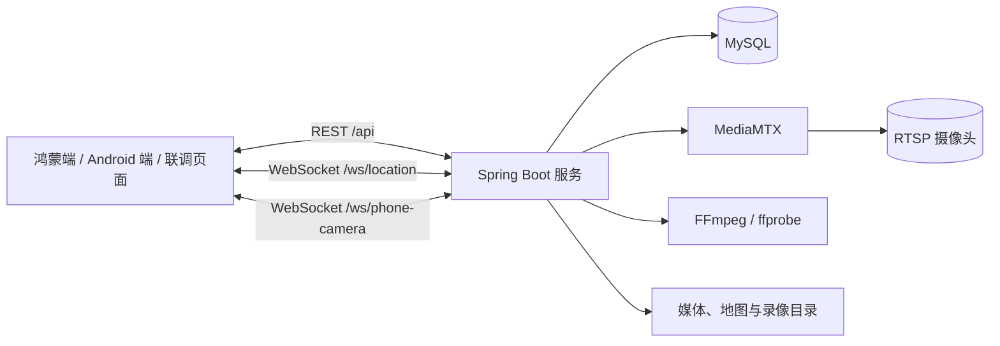
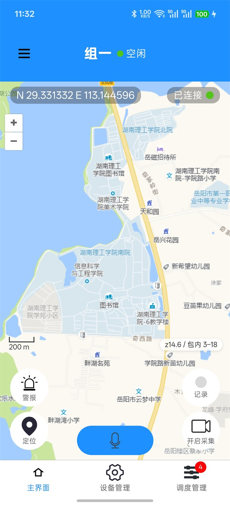
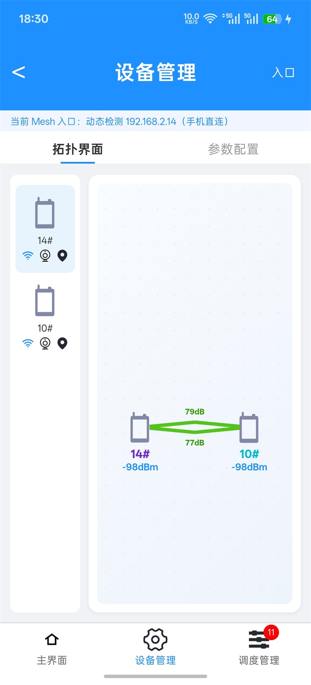
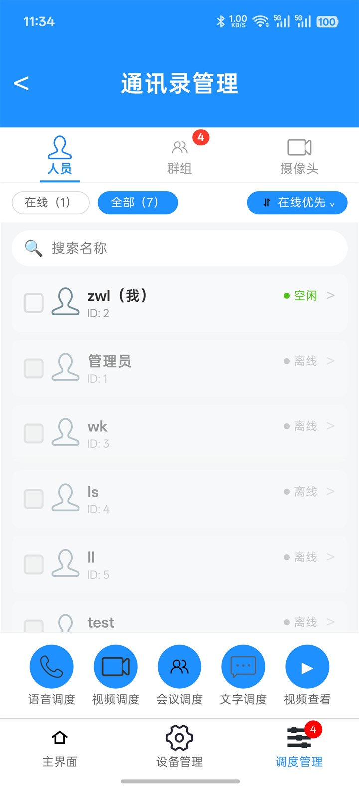

# 可视化指挥调度管理系统（后端）

**面向应急指挥与现场协同的多端联动服务**

## 项目简介

系统以地图为主界面，将人员定位、即时通信、音视频通话、摄像头接入、轨迹回放和告警上报串联到同一条业务链路中。后端承担账号与权限、群组与消息、实时位置、媒体接入、地图瓦片、通话录制以及设备代理等职责，为鸿蒙端、Android 端和联调页面提供统一接口。

本仓库是项目的后端服务代码，包含数据库脚本、接口实现、测试和少量联调静态页面，不包含鸿蒙端与 Android 端源码。移动端由团队成员开发，我负责后端部分。

## 核心能力

- **账号与权限**：登录、验证码、可配置注册开关、JWT 鉴权、BCrypt 密码存储、管理员初始化、资源归属校验与审计日志。
- **用户与群组**：用户管理、联系人、群组、群成员和角色权限，支持用户切换默认展示群组。
- **即时通信**：单聊与群聊、文本和媒体消息、消息引用、撤回、删除、未读数以及 WebSocket 实时推送。
- **音视频通话**：通话记录、忙线状态、通话媒体在场性检测、录制任务控制、录制文件读取与 FFmpeg 合成。
- **摄像头接入**：ONVIF/RTSP 接入、MediaMTX 流路径维护、WebRTC/HLS 播放、流状态诊断和按需兼容转码。
- **手机摄像头**：手机端推流注册、观看请求、会话状态查询及 `/ws/phone-camera` 信令转发。
- **地图与定位**：位置上报、在线状态、轨迹会话、历史轨迹回放，以及离线地图瓦片的导入、下载和包管理。
- **告警与设备**：一键报警、告警媒体、Mesh 设备代理、字典数据与操作审计。

## 技术栈

| 组件 | 版本 |
| --- | --- |
| Java | 21 |
| Spring Boot | 3.4.13 |
| Spring Framework | 6.2.15 |
| Spring Security | 6.4.13 |
| Spring WebSocket | 6.2.15 |
| MyBatis-Plus | 3.5.17 |
| MySQL | 8.0+ |
| Flyway | 10.20.1 |
| JJWT | 0.12.6 |
| Jackson | 2.18.5 |
| Lombok | 1.18.42 |
| 内嵌 Tomcat | 10.1.50 |
| Maven | 3.9+ |
| MediaMTX | 独立部署 |
| FFmpeg / ffprobe | 外部依赖 |
| 联调页面 | 原生 HTML / CSS / JavaScript |

## 系统架构



REST 接口统一使用 `/api` 前缀，通过 Spring Security + JWT 处理登录态和访问权限；两个 WebSocket 通道在握手阶段完成令牌校验。业务代码位于 Service 层，MediaMTX、FFmpeg/ffprobe、Mesh 等外部能力由 Manager 层封装，避免第三方协议细节直接进入业务服务。

## 代码结构

```text
src/main/java/hnist/communication/
├── controller      REST 接口
├── service         业务接口
├── service/impl    业务实现
├── manager         摄像头、录制、Mesh 等外部能力
├── mapper          MyBatis-Plus 数据访问
├── entity          数据库实体
├── dto / vo / model 请求、响应与独立模型
├── security        JWT、安全过滤与鉴权组件
├── websocket       位置和手机摄像头实时通道
├── cache           地图瓦片缓存
├── config          安全、WebSocket、Flyway 与数据初始化配置
├── exception       业务异常与统一异常处理
├── common          统一响应与事务工具
└── util            媒体校验、Range 解析等工具

src/main/resources/
├── application.yml
├── db/migration    Flyway 增量迁移脚本
└── static          联调页面

sql/communication.sql  新环境初始化脚本
docs/images            README 运行截图
```

## 运行截图

以下截图来自项目实际联调环境。客户端界面由团队成员开发，后端接口和媒体服务由本项目提供；图中账号、位置、设备及媒体信息均为演示数据。

### 鸿蒙端与 Android 端

<table>
  <tr>
    <td width="33%" align="center"><br /><sub>主界面地图</sub></td>
    <td width="33%" align="center"><br /><sub>Mesh 设备拓扑</sub></td>
    <td width="33%" align="center"><br /><sub>调度通讯录</sub></td>
  </tr>
  <tr>
    <td width="33%" align="center"><br /><sub>视频通话与录制</sub></td>
    <td width="33%" align="center"><br /><sub>历史轨迹回放</sub></td>
    <td width="33%" align="center"><br /><sub>一键报警</sub></td>
  </tr>
</table>

## 本地运行

### 环境要求

- JDK 21
- Maven 3.9+
- MySQL 8.0+
- MediaMTX、FFmpeg、ffprobe（摄像头播放、兼容转码和通话录制需要）

### 1. 获取代码

```powershell
git clone https://github.com/Adabana2007/communication.git
cd communication
```

### 2. 初始化数据库

建表脚本会自动创建 `communication` 数据库、基础表和种子数据，在项目根目录执行：

```powershell
cmd /c "mysql --default-character-set=utf8mb4 -uroot -p < sql\communication.sql"
```

应用首次启动后，Flyway 会继续执行 `src/main/resources/db/migration` 下的增量迁移。

### 3. 配置运行环境

PowerShell 示例：

```powershell
$env:DB_USERNAME = "root"
$env:DB_PASSWORD = "your-password"
$env:JWT_SECRET = "replace-with-a-long-random-secret"
$env:BOOTSTRAP_ADMIN_PASSWORD = "your-bootstrap-admin-password"
```

`BOOTSTRAP_ADMIN_PASSWORD` 只在管理员不存在时生效，登录账号为 `admin`。需要开放注册时可设置：

```powershell
$env:REGISTRATION_ENABLED = "true"
```

摄像头和通话录制功能可按本机环境补充：

```powershell
$env:CAMERA_FFMPEG = "ffmpeg"
$env:CAMERA_FFPROBE = "ffprobe"
$env:CALL_RECORDING_FFMPEG = "ffmpeg"
$env:CALL_RECORDING_FFPROBE = "ffprobe"
```

未启动 MediaMTX 或未配置 FFmpeg/ffprobe 时，账号、群组、聊天、定位、地图和告警等基础功能仍可使用，但摄像头播放、兼容转码和通话录制会受限。

### 4. 启动服务

```powershell
mvn spring-boot:run
```

服务默认监听 `8080` 端口，启动后可访问：

```text
http://localhost:8080/
```

构建可执行包：

```powershell
mvn clean package
java -jar target/communication-0.0.1-SNAPSHOT.jar
```

## 主要配置

| 环境变量 | 默认值 | 说明 |
| --- | --- | --- |
| `DB_URL` | `jdbc:mysql://127.0.0.1:3306/communication?useUnicode=true&characterEncoding=utf-8&serverTimezone=Asia/Shanghai&rewriteBatchedStatements=true` | MySQL 连接地址 |
| `DB_USERNAME` | `root` | 数据库用户名 |
| `DB_PASSWORD` | 无默认值 | 数据库密码，运行前必须设置 |
| `JWT_SECRET` | 启动时随机生成 | JWT 密钥；固定配置后重启才不会使旧令牌失效 |
| `REGISTRATION_ENABLED` | `false` | 是否开放普通用户注册 |
| `BOOTSTRAP_ADMIN_PASSWORD` | 空 | 首次启动时创建 `admin` 的管理员密码 |
| `DB_EXPECTED_PORT` | `3306` | 启动时校验的数据库端口 |
| `DB_EXPECTED_NAME` | `communication` | 启动时校验的数据库名 |
| `DB_EXPECTED_SERVER_UUID` | 空 | 可选数据库实例 UUID 校验，留空时只记录指纹 |
| `MEDIA_FFMPEG_PATH` | 空 | 视频封面生成工具，留空时跳过封面生成 |
| `CALL_RECORDING_ENABLED` | `true` | 是否启用通话录制 |
| `CALL_RECORDING_STORAGE` | `./data/call-recordings` | 通话录像存储目录 |
| `CALL_RECORDING_RTSP_BASE` / `CAMERA_RTSP_BASE` | `rtsp://127.0.0.1:8554` | MediaMTX RTSP 地址 |
| `CALL_RECORDING_FFMPEG` / `CAMERA_FFMPEG` | `ffmpeg` | FFmpeg 可执行文件 |
| `CALL_RECORDING_FFPROBE` / `CAMERA_FFPROBE` | `ffprobe` | ffprobe 可执行文件 |
| `CAMERA_COMPATIBILITY_ENABLED` | `true` | 是否启用摄像头按需兼容转码 |

`application.yml` 中的 `video.storage.path`、`recording.storage.path`、`file.upload.path` 和 `mediamtx.api` 为当前开发环境配置。换机器运行时可通过启动参数覆盖，例如：

```powershell
java -jar target/communication-0.0.1-SNAPSHOT.jar --video.storage.path=./data/videos --recording.storage.path=./data/recordings --file.upload.path=./data/uploads --mediamtx.api=http://localhost:9997
```

## 接口概览

| 模块 | 前缀 | 示例 |
| --- | --- | --- |
| 登录与认证 | `/api` | `/api/login`、`/api/auth/me`、`/api/logout` |
| 用户与群组 | `/api/users`、`/api/groups` | `/api/users/{id}/profile`、`/api/groups/{groupId}/members` |
| 即时通信 | `/api/messages`、`/api/group-messages` | `/api/messages`、`/api/group-messages/unread`、`/api/chat/media/upload` |
| 通话与录制 | `/api/calls`、`/api/call-recordings` | `/api/calls/stats`、`/api/call-recordings/{id}/file` |
| 摄像头与推流 | `/api/cameras`、`/api/phone-cameras` | `/api/cameras/{id}/play`、`/api/phone-cameras/{id}/view` |
| 定位与轨迹 | `/api/location`、`/api/trajectory` | `/api/location/update`、`/api/trajectory/session/start` |
| 离线地图 | `/api/map` | `/api/map/provinces`、`/api/map/regions/{regionId}/import` |
| 告警与设备 | `/api/alarms`、`/api/devices` | `/api/alarms`、`/api/alarms/{id}/status`、`/api/mesh/proxy` |
| 字典与视频 | `/api/dicts`、`/api/videos` | `/api/dicts/types`、`/api/videos` |
| 实时通道 | `/ws` | `/ws/location`、`/ws/phone-camera` |

## License

本项目采用 [MIT License](LICENSE)。
